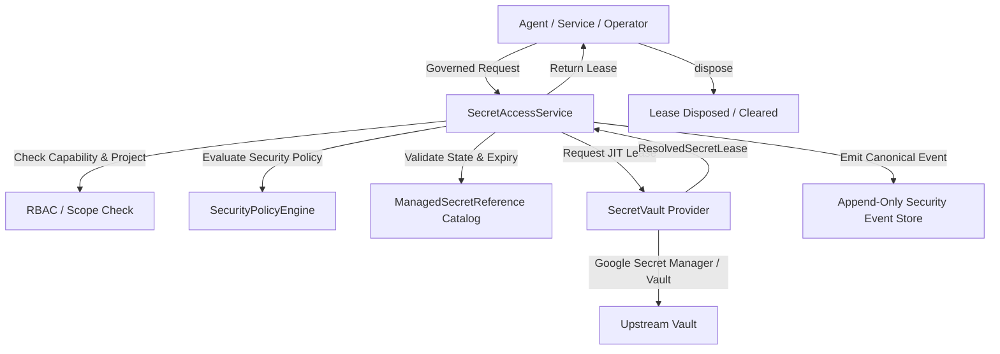
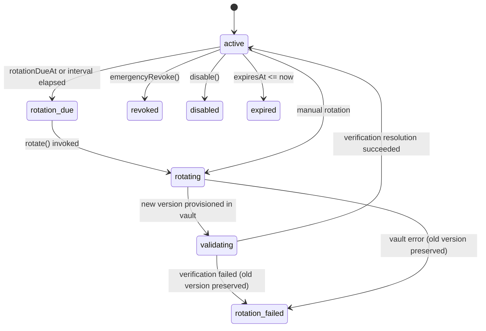

# Security Foundation V1 — Layer 7: Secrets Management, Credential Vault & Key Rotation

## 1. Overview & Core Invariants

The AI Workforce secrets management system enforces zero raw secret storage in application databases, zero raw secret exposure to client interfaces, and just-in-time, short-lived secret leasing for backend components.

### Core Security Invariants

1. **Never store raw secrets in Firestore**: Only metadata is stored (`ManagedSecretReference`).
2. **Never expose raw secrets to the browser**: No endpoint or UI view returns plaintext secret values.
3. **Never place secrets in `VITE_*` configuration**: Client bundles contain zero credentials.
4. **Never log secrets**: Canonical events, receipts, and application logs are scrubbed by automated redactors.
5. **Zero model exposure**: Agents never receive raw credentials in prompts. Tools interact via the `CredentialBroker`.
6. **Just-In-Time resolution**: Secrets are leased only when needed and disposed immediately after execution.

---

## 2. Architecture & Components



### 2.1 ManagedSecretReference Model

Defined in `contracts/secret-reference.ts`:

- `id`: Unique reference identifier (e.g. `github-deploy-key`).
- `ref`: Canonical URI (`secret://github-deploy-key`).
- `provider`: Vault provider (`gcp_secret_manager`, `azure_key_vault`, `aws_secrets_manager`, `external_vault`, `in_memory_vault`).
- `providerResource`: Provider resource path (e.g. `projects/PROJECT/secrets/SECRET_NAME`).
- `purpose`: Bounded description of intended usage.
- `projectId`: Scoped project identifier (optional for global secrets).
- `environment`: Bound deployment environment (`local`, `test`, `staging`, `production`).
- `allowedConsumers`: Allowlist of authorized principals (e.g. `["agent:developer", "service:deployment"]`).
- `status`: Lifecycle state (`active`, `rotation_due`, `rotating`, `validating`, `disabled`, `revoked`, `expired`, `unavailable`, `rotation_failed`).
- `rotationPolicy`: Automated rotation rules (`intervalDays`, `manualApprovalRequired`).

### 2.2 Vault Provider Abstraction (`SecretVault`)

Provider-neutral interface declared in `contracts/vault.ts`:

- `resolve(reference, context)`: Resolves secret lease.
- `createSecret(reference, initialValue, context)`: Provisions new secret in provider.
- `rotate(reference, newValue, context)`: Adds new version in provider.
- `revoke(reference, context)`: Destroys or disables secret version in provider.
- `health()`: Operational status and reachability.

### 2.3 Google Cloud Secret Manager Adapter

Implemented in `adapters/vault/google-secret-manager-vault.ts`:

- Production integration using Google Cloud Secret Manager.
- Uses Application Default Credentials (ADC) or workload identity.
- Resolves paths according to GCP naming: `projects/{project}/secrets/{secretId}/versions/{version}`.
- Minimum required production IAM:
  - `roles/secretmanager.secretAccessor` for runtime resolution.
  - `roles/secretmanager.secretVersionManager` only for services executing automated rotations.
  - Never grant `roles/owner` or `roles/editor`.

### 2.4 Credential Broker

Implemented in `core/security/credential-broker.ts`:

- Wraps tool execution with ephemeral secret access:
  ```typescript
  await credentialBroker.executeWithSecret(
    agentContext,
    secretRef,
    async (secretValue) => {
      return await externalTool.execute(secretValue, args);
    },
  );
  ```
- Guarantees `lease.dispose()` in `finally` blocks.
- The raw credential never touches the agent prompt or memory.

---

## 3. Rotation Lifecycle & State Machine



1. **State Preservation**: A failed rotation never revokes or deletes the previously active credential version.
2. **Emergency Revocation**: Governed through `SecurityPolicyEngine` and `DestructiveActionService`.

---

## 4. Canonical Security Events

The following canonical security events are emitted:

- `secret_reference_created`
- `secret_reference_updated`
- `secret_reference_disabled`
- `secret_reference_revoked`
- `secret_access_requested`
- `secret_access_granted`
- `secret_access_denied`
- `secret_resolution_failed`
- `secret_rotation_due`
- `secret_rotation_started`
- `secret_rotation_succeeded`
- `secret_rotation_failed`
- `secret_expired`
- `secret_leak_detected`

All events are filtered through `normalizeSecurityEvent` and scrubbed by `SECRET_KEYS` and `SECRET_VALUE` patterns to prevent secret leakage.
