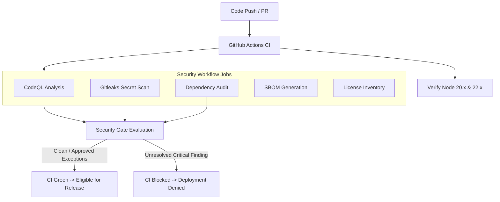

# Security Foundation V1 — Layer 8: Secure SDLC, SAST, Dependency & Software Supply-Chain Security

## 1. Overview & Policy

Layer 8 defines automated security guardrails across the development lifecycle, pull request gates, and CI/CD pipelines to ensure software supply-chain integrity.

### Core Policies

1. **Zero Secret Leakage**: Gitleaks and pre-commit secret scanners scan all commits. Real secret detection triggers immediate CI failure and automated Layer 7 credential rotation.
2. **SAST via CodeQL**: Automated semantic static code analysis for JavaScript and TypeScript with the `security-extended` suite.
3. **Dependency Vulnerability Enforcement**: `npm audit` runs on every pull request. Critical and High vulnerabilities fail closed unless covered by an active, unexpired exception in `docs/security/dependency-exceptions.md`.
4. **Least-Privilege GitHub Actions**: Workflows declare minimal explicit permissions (e.g. `contents: read`). Wildcard `write-all` is prohibited.
5. **Software Bill of Materials (SBOM)**: CycloneDX-compatible JSON SBOM is generated for all builds and tracked as release artifacts.
6. **Deployment Security Gate**: Deployments to staging and production fail closed if any unmitigated critical SAST finding, secret leak, or unapproved critical CVE exists.

---

## 2. CI Security Pipeline



### 2.1 CodeQL Static Analysis

- Defined in `.github/workflows/security.yml`.
- Targets `javascript-typescript`.
- Triggers on pushes to `main`, pull requests, and weekly schedules.
- Permissions:
  ```yaml
  permissions:
    contents: read
    security-events: write
  ```

### 2.2 Secret Scanning (Gitleaks)

- Configuration: `.gitleaks.toml`.
- Scans git history and workspace files.
- Uses narrow exclusions only for synthetic test mock strings.
- Local developer command: `npm run security:secrets`.

### 2.3 Dependency Auditing (`npm run security:deps`)

- Evaluates `npm audit` for both root and UI workspaces.
- Reconciles identified vulnerabilities against `docs/security/dependency-exceptions.md`.
- Fails closed on any unexpected critical or high severity finding, or any exception past its `Expiry Date`.

### 2.4 Software Bill of Materials (SBOM)

- Command: `npm run security:sbom`.
- Generates `dist/sbom-root.json` and `dist/sbom-ui.json`.
- Uploaded as GitHub Actions artifacts for release verification.

### 2.5 License Inventory (`npm run security:license`)

- Generates `dist/licenses.json`.
- Categorizes packages into:
  - **Allowed**: MIT, Apache-2.0, BSD-2-Clause, BSD-3-Clause, ISC.
  - **Review Required**: Copyleft / MPL / LGPL / unknown licenses.
  - **Prohibited**: AGPL, proprietary/commercial restrictions without enterprise license.

---

## 3. Deployment Security Gate

Before release execution, `DeploymentSecurityGate` (`core/security/deployment-security-gate.ts`) evaluates the security posture:

- Open critical SAST finding $\rightarrow$ **DENIED**
- Confirmed secret leak $\rightarrow$ **DENIED**
- Unapproved critical CVE $\rightarrow$ **DENIED**

### Governed Emergency Override

An emergency deployment override cannot be granted via a simple flag. It requires:

1. Operator principal with `manage_security_policy` capability.
2. Specific list of accepted `findingIds`.
3. Minimum 10-character written justification.
4. Hard expiry timestamp.
5. In production: verified MFA and reauthentication.
6. Emits canonical `security_override_applied` audit event.
